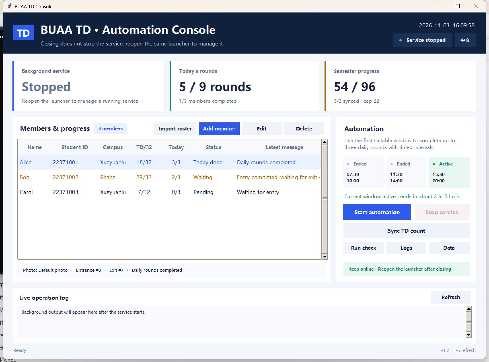
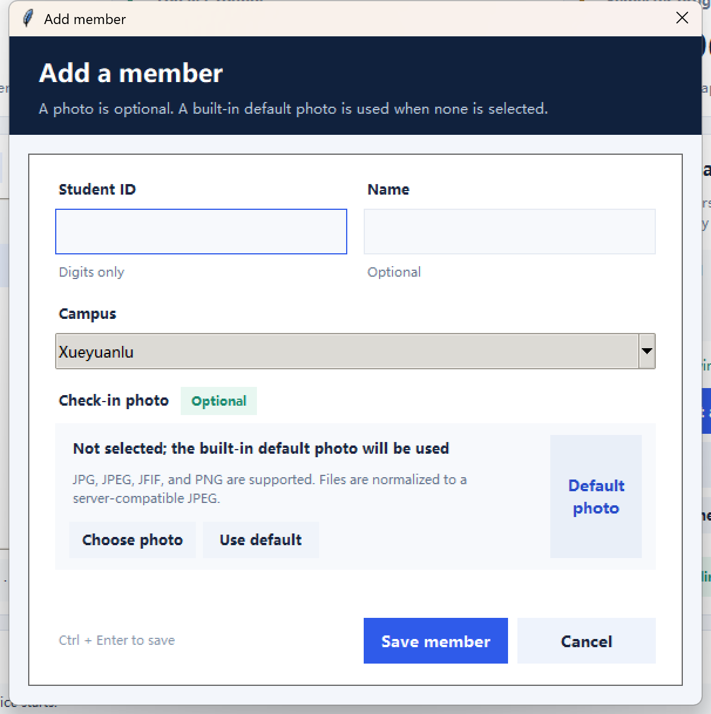

**English** | [简体中文](README.zh-CN.md)

# BUAA TD Automation Console

A Windows desktop console for managing BUAA TD check-in schedules from one place. The background service runs independently of the console window, so closing the window does not stop automation.




> Use this project only when you are authorized to automate the relevant account and when doing so complies with your institution's rules. You are responsible for the accounts and data you configure.

## Highlights

- Clean desktop dashboard with member progress, TD counts, schedule windows, and live logs.
- One-click English/Chinese switching, persisted between launches.
- Optional check-in photos with a valid built-in JPEG fallback.
- Add, edit, import, and remove roster members from the UI.
- Independent detached background service with start/stop controls.
- Completes up to three daily rounds with configurable intervals after the first suitable window begins.
- Automatic retry for transient network failures.
- Preflight health check for roster, photos, machines, and TD connectivity.
- No runtime third-party package required for standard JPG workflows.



## Quick Start

### Requirements

- Windows 10 or Windows 11
- Python 3.10 or newer with Tk support
- Campus network or the corresponding school VPN for TD access

### Run

1. Connect to the campus network or school VPN.
2. Double-click `start.bat` or `一键启动.bat`.
3. Import a roster or add members from the console.
4. Click **Run check** to verify the local configuration and TD connectivity.
5. Click **Start automation**. The console may be closed safely afterward.

The `EN` / `中文` control at the top-right switches the complete console interface and saves the selected language.

## Roster

Create a `users.txt` file in the project root using one member per line:

```text
student_id name campus
22371001 Alice Xueyuanlu
22371002 Bob Shahe
```

Chinese campus names are also accepted:

```text
22371001 张三 学院路
22371002 李四 沙河
```

The public repository contains only [users.example.txt](users.example.txt). Local rosters and runtime data are ignored by Git.

## Photo Behavior

- A photo is optional. If selected, it is used for that member's entrance and exit requests.
- Without a custom photo, `data/images/default.jpg` is generated and used automatically.
- JPG, JPEG, JFIF, and PNG are accepted. PNG files are converted to JPEG when Pillow is available.
- Custom images receive content-derived filenames, preventing same-name files from overwriting each other.
- Editing a member without choosing a new photo preserves the existing custom photo.
- Missing or unreadable photos are repaired automatically before the background service starts.

## Scheduling and Reliability

The default schedule uses three daily windows in Asia/Shanghai:

| Window | Time |
| --- | --- |
| Morning | `07:30-10:00` |
| Midday | `11:30-14:00` |
| Afternoon | `15:30-20:00` |

The scheduler uses the first suitable window each day, then completes up to three rounds with the configured 3–4 minute intervals. It does not wait for each window to perform one round.

Rules:

- Up to three complete entrance/exit rounds per member per day.
- All three rounds may be completed in the same eligible time window.
- If the window ends before all three rounds finish, remaining rounds continue in a later eligible window.
- A member is skipped automatically after reaching 32 TD records.
- Transient network errors retry automatically up to five times.
- New rounds are not started when too little time remains in the current window.
- Completion state is persisted, so restarting the console does not repeat a completed window.

## Console Features

- View service PID, running state, current window, and next window.
- Inspect per-member TD count, completed rounds, machine assignment, photo type, and latest state.
- Import a roster, add members, edit members, and delete members.
- Switch between Chinese and English instantly.
- Open logs or the local data directory.
- Sync the latest TD exercise count from the server.
- Run a connectivity and configuration health check.

Keyboard shortcuts:

| Shortcut | Action |
| --- | --- |
| `Ctrl+N` | Add a member |
| `F2` | Edit the selected member |
| `F5` | Refresh the dashboard |
| `Ctrl+Enter` | Save the member dialog |

## Project Layout

```text
buaatd/
  gui.py          Desktop console
  i18n.py         Chinese and English UI strings
  scheduler.py    Time-window scheduler and retry logic
  client.py       TD TCP protocol client
  photo.py        Default/custom photo handling
  wizard.py       Member setup and asset repair
tests/            UI, photo, scheduler, and protocol tests
docs/             Screenshots
data/             Local runtime data (ignored by Git)
```

## Command Line

Launch the desktop console:

```bash
python -m buaatd gui
```

Other commands:

```bash
python -m buaatd setup --file users.txt
python -m buaatd start
python -m buaatd status
python -m buaatd once
python -m buaatd count --refresh
python -m buaatd stop
```

## Tests

```bash
python -m unittest discover -v
```

The test suite covers member dialogs, language switching, custom/default photos, asset repair, three-round daily scheduling, transient network retries, and a real local TCP simulation of the entrance/photo/exit protocol.

## Privacy

- Roster files and all runtime data are stored locally.
- No telemetry or analytics are included.
- `data/`, `users.txt`, logs, PIDs, and generated images are excluded from the Git repository.

## Contributing

Issues and pull requests are welcome. Read [CONTRIBUTING.md](CONTRIBUTING.md) before submitting changes.

## License

Released under the [MIT License](LICENSE).

The protocol implementation is informed by [AutoTD](https://github.com/DeNeRATe-cool/AutoTD).
