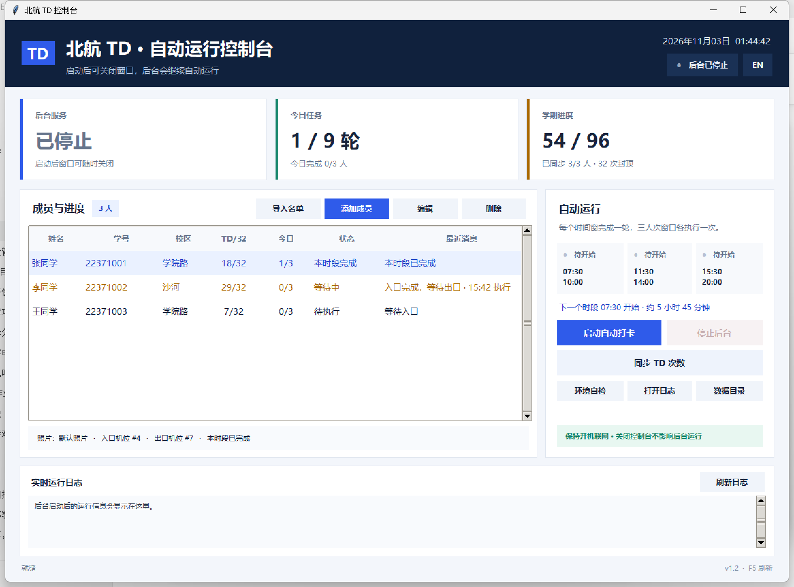
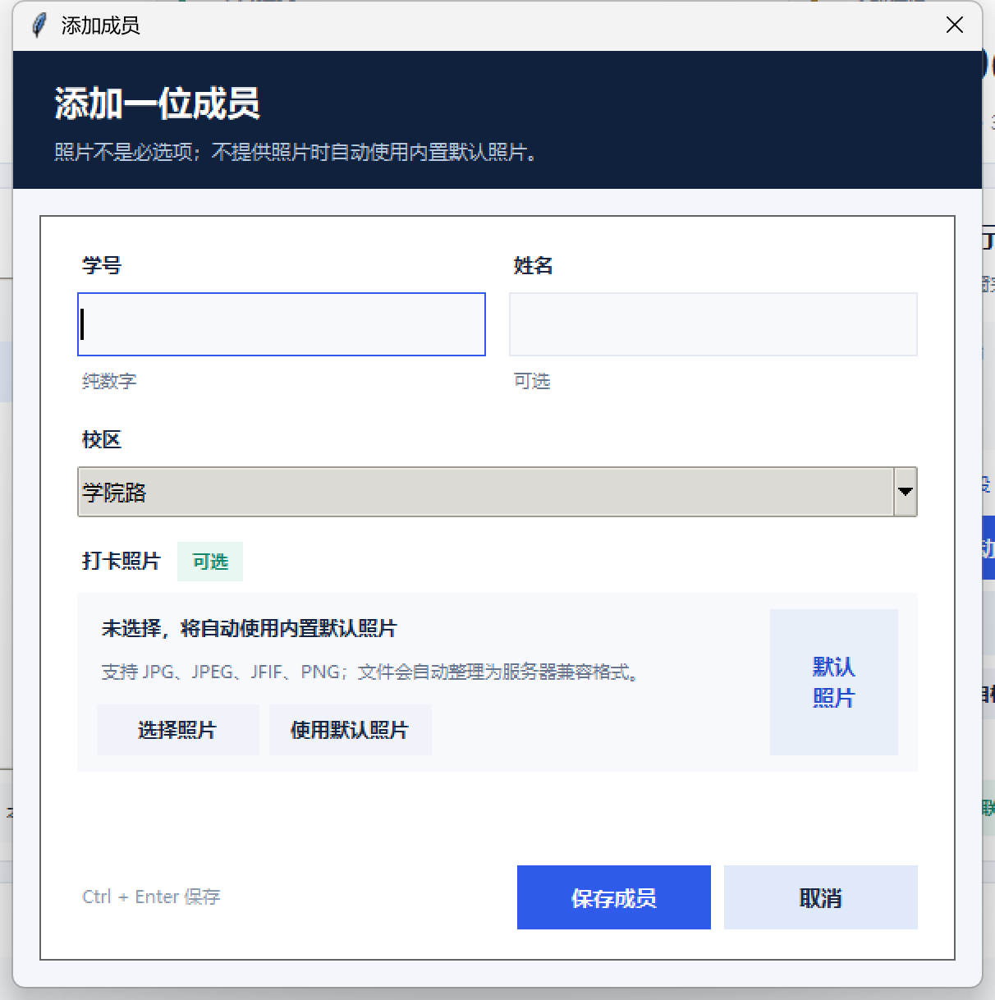

[English](README.md) | **简体中文**

# 北航 TD 自动运行控制台

双击打开可视化控制窗口，管理成员、启动后台任务并查看实时进度。后台进程与控制台窗口相互独立，启动后关闭窗口也不会中断自动打卡。



## 开始使用

1. 连接**校园网**或学校 VPN。
2. 双击 **`一键启动.bat`**，也可以使用英文入口 `start.bat`。
3. 点击“导入名单”或“添加成员”。
4. 点击“启动自动打卡”，然后可以关闭控制台。
5. 下次打开控制台可查看后台是否仍在运行。

控制台右上角的 `EN` / `中文` 按钮可以即时切换界面语言，选择会保存到本地设置。

添加成员时，学号和校区是必填项；姓名和照片都可以不填。未选择照片时自动使用内置默认照片，不会影响启动。

导入名单的 `users.txt` 格式：

```text
学号 姓名 校区
22371001 张三 学院路
22371002 李四 沙河
```

同个学号重复导入会更新原成员，不会删除名单中的其他成员。公开仓库只包含 [users.example.txt](users.example.txt)，实际 `users.txt` 和 `data/` 不会提交。

## 控制台功能

- 查看后台运行状态、进程号和当前调度时段。
- 查看每位成员的今日轮次、本学期 TD 次数与最近运行消息。
- 导入或追加名单、添加成员、编辑成员、删除成员。
- 一键启动和停止后台任务。
- 连接服务器同步最新 TD 次数。
- 运行环境自检：检查照片、机位和 TD 服务器网络连接。
- 查看今天的实时运行日志。
- 一键切换中英文界面。
- 关闭窗口后后台继续运行，不影响自动任务。

双击成员或按 `F2` 可以编辑；`Ctrl+N` 添加成员；`F5` 刷新界面。

“同步 TD 次数”会产生服务器查询请求，“环境自检”只测试服务器端口连接，不会提交打卡。两者都需要连接校园网或相应 VPN。

## 照片规则

- 照片完全可选：选中后会用于该成员的入口和出口打卡。
- 未选择照片：自动使用 `data/images/default.jpg`。
- 支持 JPG、JPEG、JFIF、PNG；PNG 会转换为服务器更容易接受的 JPEG。
- 自定义照片会按内容生成独立文件名，不会因为多个照片同名而互相覆盖。
- 编辑成员但不重新选择照片时，会保留原来的自定义照片。
- 启动前会自动修复缺失或无法读取的照片，并检查机位配置。



## 文件说明

| 文件 | 作用 |
| --- | --- |
| `一键启动.bat` / `start.bat` | 打开可视化控制台 |
| `创建桌面快捷方式.bat` / `create-shortcut.bat` | 创建桌面快捷方式 |
| `停止.bat` / `stop.bat` | 紧急停止后台任务 |
| `立即打一轮.bat` / `run-once.bat` | 在当前窗口立即执行完整批量任务 |
| `users.example.txt` | 批量名单格式示例 |

运行数据和日志保存在 `data/` 中，包括成员、状态、日志和进程信息。不要在后台运行时手动修改 `data/state.json`。

运行自动测试：

```bash
python -m unittest discover -v
```

## 自动规则

- 每天最多 3 次，对应三个时间段各一次完整入口和出口。
- 同一时间窗完成后不会重复执行下一轮。
- 短暂网络异常会自动重试，最多 5 次；接近窗口结束时不会发起来不及完成的轮次。
- 时间窗：`07:30-10:00`、`11:30-14:00`、`15:30-20:00`。
- 每人本学期达到 32 次后自动跳过。
- 运行期间电脑需要保持开机、联网，并连接校园网。
- TD 服务器：`10.212.28.38:8888`。

## 命令行

```bash
python -m buaatd gui
python -m buaatd setup --file users.txt
python -m buaatd start
python -m buaatd status
python -m buaatd once
python -m buaatd count --refresh
python -m buaatd stop
```

## 开源与许可

项目使用 [MIT License](LICENSE) 开源。协议实现参考 [AutoTD](https://github.com/DeNeRATe-cool/AutoTD)。

请仅在你拥有授权、并符合学校相关规定的范围内使用本项目。
